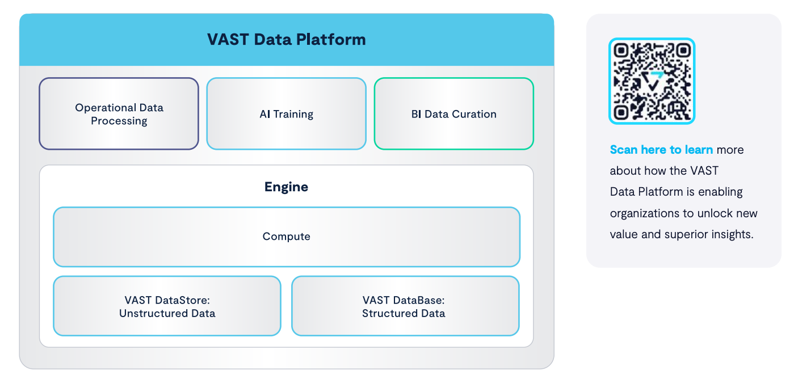

[](https://pypi.org/project/vastdb)

# VAST DB Python SDK

A Python client for the [VAST Database](https://vastdata.com/database) and [VAST Catalog](https://vastdata.com/blog/vast-catalog-treat-your-file-system-like-a-database).

### Supports:

- Schema and table management
- Efficient data ingest and querying
- Advanced filtering with predicate pushdown
- Direct integration with PyArrow and DuckDB
- File system querying through VAST Catalog

[](https://vastdata.com/database)

For technical details about VAST Database architecture, see the [whitepaper](https://vastdata.com/whitepaper/#TheVASTDataBase).

## Getting Started

### Requirements

- Linux client with Python 3.10 - 3.13, and network access to the VAST Cluster
- VAST Cluster release `5.0.0-sp10` or later
  - If your VAST Cluster is running an older release, please contact customer.support@vastdata.com.
- [Virtual IP pool configured with DNS service](https://kb.vastdata.com/documentation/docs/configuring-the-vast-cluster-dns-service)
- [S3 access & secret keys on the VAST cluster](https://kb.vastdata.com/documentation/docs/managing-s3-user-access-from-the-vast-web-ui)
- [Tabular identity policy with the proper permissions](https://kb.vastdata.com/documentation/docs/creating-identity-policies)

### Installation

```bash
pip install vastdb
```

See the [Release Notes](CHANGELOG.md) for the SDK.

### Connect

```python
import vastdb

session = vastdb.connect()
```

`vastdb.connect(access: str | None, secret: str | None, endpoint: str | None)`

If omitted, `access`, `secret`, and `endpoint` are taken from the environment:
- `AWS_ACCESS_KEY_ID`
- `AWS_SECRET_ACCESS_KEY`
- `AWS_S3_ENDPOINT_URL`

### Schema, table, insert, select

Transactions group mutations. Keep the transaction open while you consume a
[`pyarrow.RecordBatchReader`](https://arrow.apache.org/docs/python/generated/pyarrow.RecordBatchReader.html)
returned by `select()`.

```python
import pyarrow as pa
import vastdb

with session.transaction() as tx:
    bucket = tx.bucket("bucket-name")
    schema = bucket.create_schema("qs_basic", fail_if_exists=False)

    columns = pa.schema([
        ("c1", pa.int16()),
        ("c2", pa.float32()),
        ("c3", pa.utf8()),
    ])
    table = schema.create_table("quickstart_table", columns, fail_if_exists=False)

    sample = pa.table(schema=columns, data=[
        [111, 222, 333],
        [0.5, 1.5, 2.5],
        ["a", "bb", "ccc"],
    ])
    table.insert(sample)

   # SELECT * from mytable. reader must be fully consumed inside this transaction.
    reader: RecordBatchReader = mytable.select()
    result: RecordBatch = reader.read_all()
    assert result == sample

    # the transaction is automatically committed when exiting the context
```

Supported data types: [docs/types.md](docs/types.md).
See [docs/predicate.md](docs/predicate.md) for constructing predicates with Ibis.

## runnable examples with more features:
| Feature / Workflow | Example File | What it Covers                                                                                            |
| :--- | :--- |:----------------------------------------------------------------------------------------------------------|
| **The Basics** | [`examples/quickstart.py`](examples/quickstart.py) | Connecting via environment variables, basic schemas/tables, simple inserts, and querying with predicates. |
| **Direct S3 Ingest** | [`examples/import_parquet.py`](examples/import_parquet.py) | Creating tables directly from existing Parquet files on VAST without client-side copying.                 |
| **Advanced Querying** | [`examples/query_processing.py`](examples/query_processing.py) | Parallelizing queries via `QueryConfig`, VAST Catalog querying, and DuckDB post-processing.               |
| **Performance Tuning** | [`examples/table_types.py`](examples/table_types.py) | Creating partitioned tables (for filter pruning) and sorted tables (for range scans).                     |
| **Architecture Features** | [`examples/advanced_features.py`](examples/advanced_features.py) | Managing semi-sorted projections, reading from snapshots, and audit logging.                              |
| **Blob Expansion** | [`examples/blob_expansion.py`](examples/blob_expansion.py) | Expand a blob column into a target table; create, add/drop columns, mandatory fields, and drop. |
| **AI / Machine Learning** | [`examples/vector_search.py`](examples/vector_search.py) | Nearest-neighbor searches over a vector-indexed column (requires ADBC).                                   |

## More Information

See these blog posts for more examples:

- https://vastdata.com/blog/the-vast-catalog-in-action-part-1
- https://vastdata.com/blog/the-vast-catalog-in-action-part-2

See also the [full Vast DB Python SDK documentation](https://vastdb-sdk.readthedocs.io/en/latest/)
